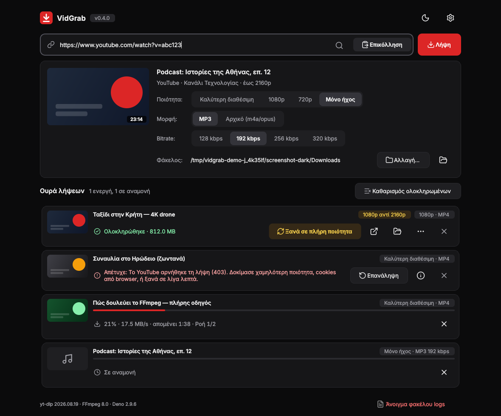
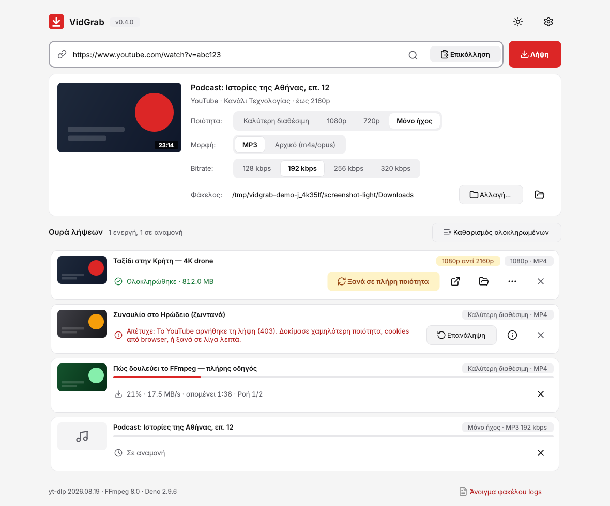
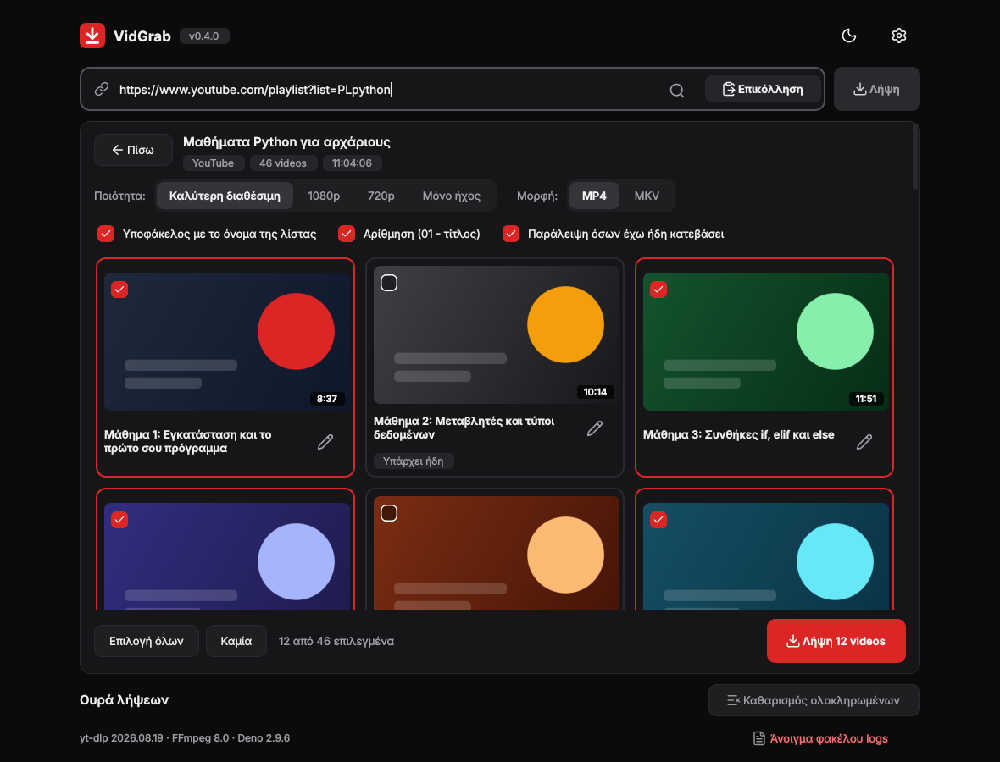
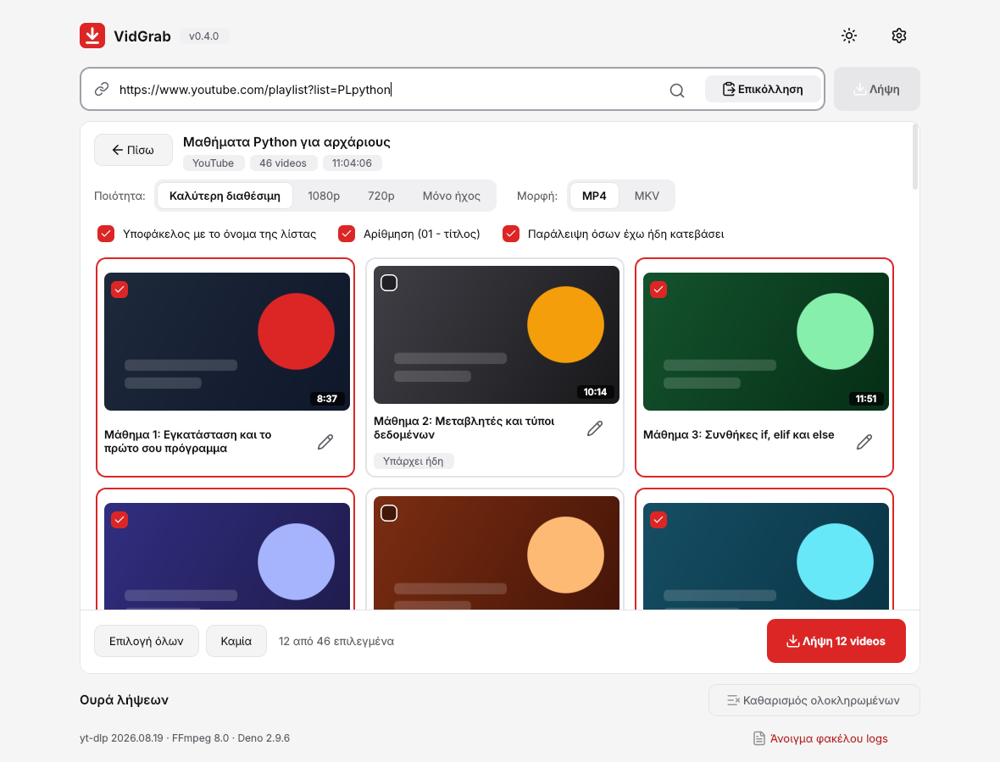
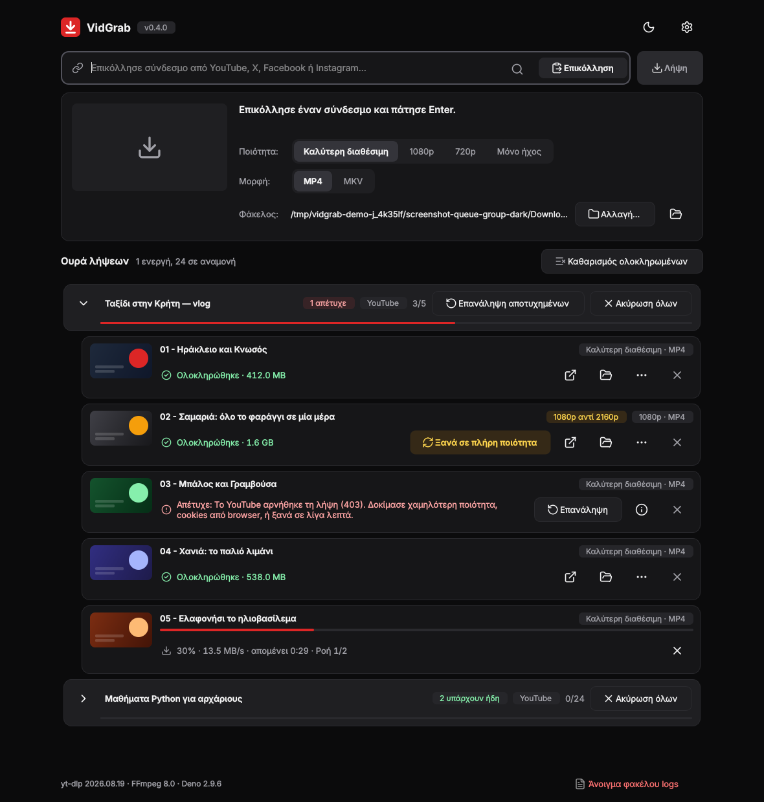
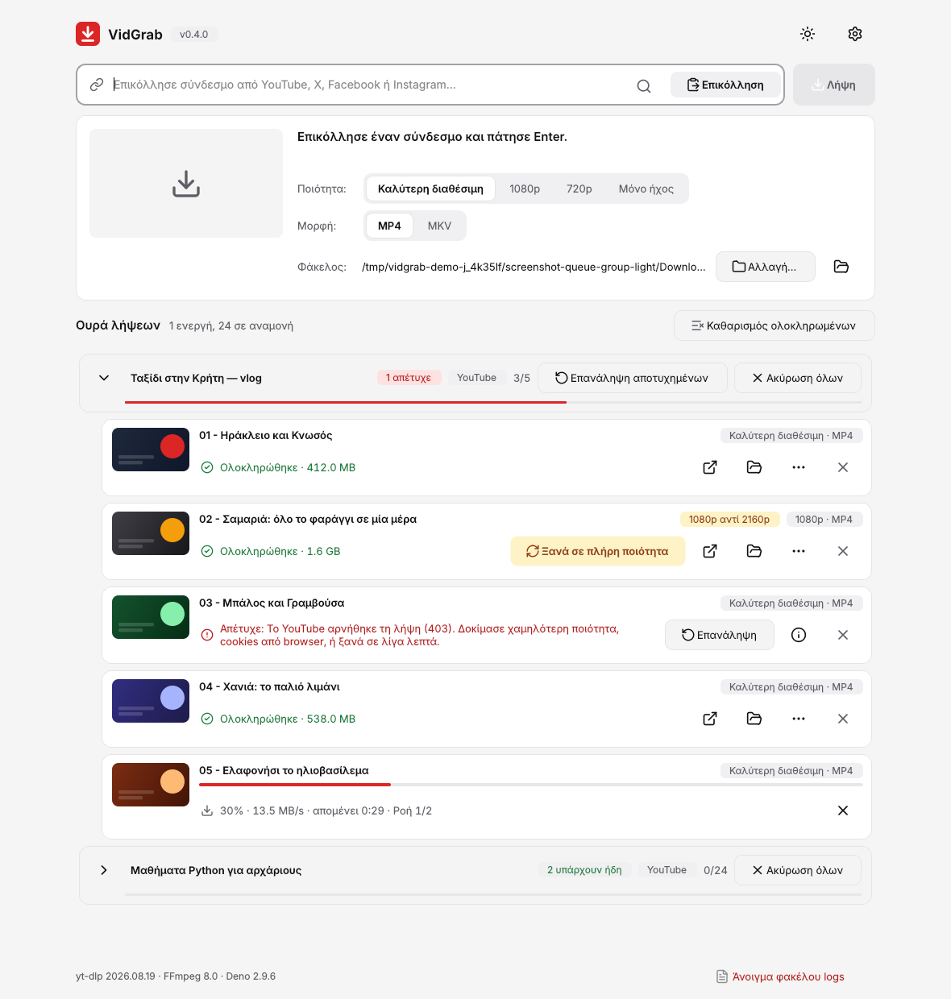
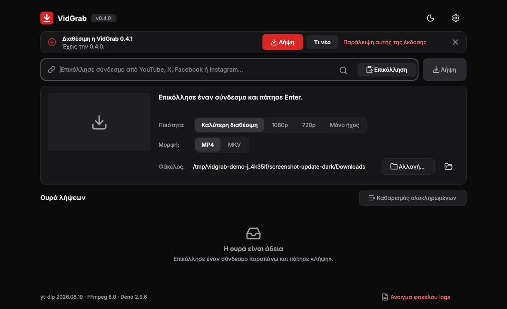
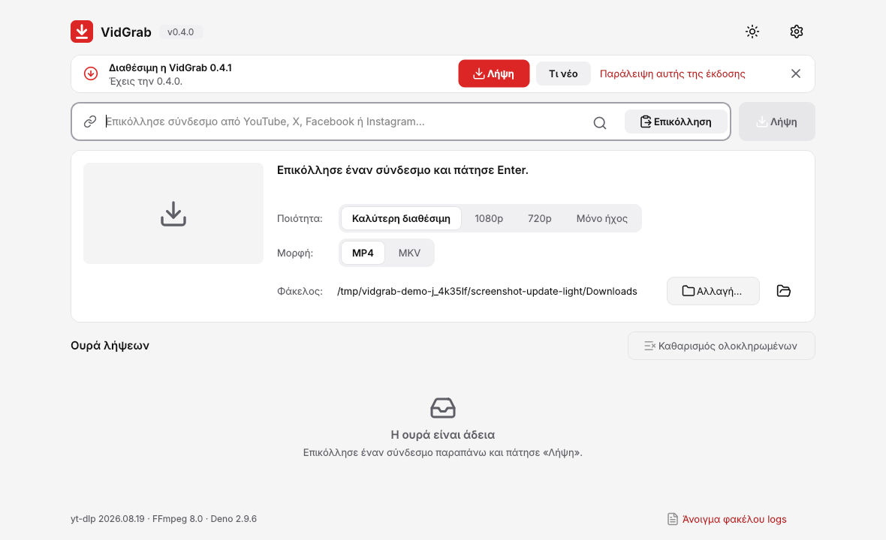
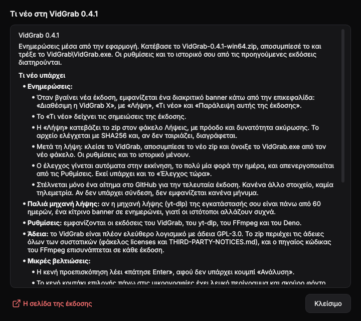
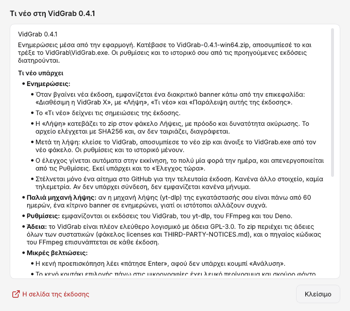

# VidGrab

Πρόγραμμα για Windows που κατεβάζει βίντεο και ήχο από το YouTube, το X, το Facebook και
το Instagram. Επικολλάς έναν σύνδεσμο, διαλέγεις ποιότητα και μορφή, και πατάς «Λήψη».
Βασίζεται στο [yt-dlp](https://github.com/yt-dlp/yt-dlp) και περιλαμβάνει το FFmpeg και
το Deno, οπότε δεν χρειάζεται να εγκαταστήσεις τίποτα άλλο.

| Σκούρο θέμα | Φωτεινό θέμα |
| --- | --- |
|  |  |
|  |  |
|  |  |
|  |  |
|  |  |

_Οι εικόνες είναι από δοκιμαστικά δεδομένα._

## Τι κάνει

- Προεπισκόπηση με τίτλο, μικρογραφία και διάρκεια πριν από τη λήψη.
- Ποιότητα: Καλύτερη διαθέσιμη, 1080p, 720p ή Μόνο ήχος.
- Μορφή: **MP4** (παίζει παντού· η εικόνα δεν επανακωδικοποιείται ποτέ) ή **MKV**. Για ήχο,
  **MP3** (128–320 kbps) ή ο αρχικός ήχος χωρίς μετατροπή.
- Λίστες αναπαραγωγής και posts με πολλά videos: διαλέγεις ποια θα κατέβουν, τα μετονομάζεις,
  και όσα έχεις ήδη κατεβάσει ξεκινούν αποεπιλεγμένα.
- Ουρά λήψεων με πρόοδο, ακύρωση και επανάληψη.
- Cookies από Firefox, Chrome, Edge ή αρχείο cookies.txt, για περιεχόμενο που θέλει σύνδεση.
- Κατανοητά μηνύματα σφάλματος (ιδιωτικό βίντεο, γεωγραφικός περιορισμός, απαιτείται σύνδεση…).
- Σκούρο και φωτεινό θέμα, ή αυτόματα όπως τα Windows.
- Ειδοποίηση όταν βγαίνει νέα έκδοση, με λήψη και έλεγχο του αρχείου μέσα από την εφαρμογή.

## Λήψη και εγκατάσταση

1. Από τη σελίδα [Releases](https://github.com/korinious/vidgrab/releases/latest) κατέβασε
   το `VidGrab-<έκδοση>-win64.zip`.
2. Αποσυμπίεσέ το (δεξί κλικ → «Εξαγωγή όλων»), π.χ. στα Έγγραφα.
3. Άνοιξε το `VidGrab\VidGrab.exe`.

Χρειάζονται Windows 10 ή 11, 64-bit. Δεν γίνεται εγκατάσταση: για να το αφαιρέσεις, σβήνεις
τον φάκελο.

### Windows SmartScreen

Το VidGrab.exe δεν είναι ψηφιακά υπογεγραμμένο, οπότε στο πρώτο άνοιγμα τα Windows μπορεί να
δείξουν «Τα Windows προστάτευσαν τον υπολογιστή σας». Πάτησε **«Περισσότερες πληροφορίες»**
και μετά **«Εκτέλεση οπωσδήποτε»**. Αν θέλεις να ελέγξεις το αρχείο, κάθε έκδοση έχει και
το `SHA256SUMS.txt`:

```powershell
Get-FileHash .\VidGrab-0.4.0-win64.zip -Algorithm SHA256
```

### Ενημερώσεις

Από την 0.4.0, το VidGrab ελέγχει στην εκκίνηση, το πολύ μία φορά την ημέρα, αν υπάρχει
νεότερη έκδοση, και σε ενημερώνει με ένα banner. Η «Λήψη» κατεβάζει το νέο zip στον φάκελο
Λήψεις και ελέγχει το SHA256 του. Μετά κλείνεις το VidGrab, αποσυμπιέζεις το νέο zip και
ανοίγεις το νέο VidGrab.exe. Οι ρυθμίσεις και το ιστορικό μένουν.

Ο έλεγχος είναι ένα αίτημα προς το GitHub
(`api.github.com/repos/korinious/vidgrab/releases/latest`), που στέλνει μόνο την έκδοση του
VidGrab (`User-Agent: VidGrab/0.4.0`). Καμία τηλεμετρία, κανένα άλλο στοιχείο. Ο αυτόματος
έλεγχος απενεργοποιείται από τις Ρυθμίσεις.

## Πού αποθηκεύονται τα δεδομένα

| Τι | Πού |
| --- | --- |
| Ρυθμίσεις | `%APPDATA%\VidGrab\settings.json` και `ui.json` |
| Αρχείο καταγραφής (logs) | `%LOCALAPPDATA%\VidGrab\logs\vidgrab.log` («Άνοιγμα φακέλου logs» κάτω δεξιά) |
| Ιστορικό λήψεων | `%LOCALAPPDATA%\VidGrab\download-archive.txt` (καθαρίζεται από τις Ρυθμίσεις) |
| Προσωρινά αρχεία λήψεων | `%LOCALAPPDATA%\VidGrab\tmp\` (σβήνονται αυτόματα) |

Τα βίντεο αποθηκεύονται στον φάκελο που διαλέγεις (από προεπιλογή, στις Λήψεις).

## Αποποίηση ευθύνης

Το VidGrab είναι ένα εργαλείο. **Εσύ είσαι υπεύθυνος/η** για το τι κατεβάζεις και πώς το
χρησιμοποιείς: να σέβεσαι τα πνευματικά δικαιώματα και τους όρους χρήσης κάθε πλατφόρμας, και
να κατεβάζεις μόνο περιεχόμενο που σου ανήκει ή για το οποίο έχεις άδεια. Το VidGrab δεν
συνδέεται με το YouTube, το X, το Facebook, το Instagram ή άλλη πλατφόρμα, και παρέχεται
«ως έχει», χωρίς καμία εγγύηση.

## Άδεια

Το VidGrab είναι ελεύθερο λογισμικό με άδεια
[GNU General Public License v3.0 ή νεότερη](LICENSE). Το zip περιέχει επίσης το FFmpeg
(GPL-3.0), το Deno (MIT), το Qt/PySide6 (LGPL-3.0), την Python (PSF) και πακέτα Python με τις
δικές τους άδειες: δες το [THIRD-PARTY-NOTICES.md](THIRD-PARTY-NOTICES.md) και τον φάκελο
`licenses` του zip. Ο πηγαίος κώδικας του FFmpeg επισυνάπτεται σε κάθε έκδοση.

## Development

VidGrab is Python 3.12 + PySide6, with yt-dlp used as a library; it is packaged with
PyInstaller (`--onedir`) and dependencies are managed with [uv](https://docs.astral.sh/uv/).

```bash
uv sync                                  # install dependencies (incl. dev tools)
uv run pytest                            # tests (headless Qt; no network)
uv run ruff check . && uv run ruff format --check .
uv run python -m vidgrab                 # run the app
uv run python -m vidgrab --self-check    # check that ffmpeg/ffprobe/deno are found
```

Put `ffmpeg`, `ffprobe` and `deno` in `./bin/` (or on `PATH`) to download for real. The
conventions (UI strings in `strings.py`, Qt-free `core/`, theme tokens, tests that never touch
the network, release procedure) are in [CLAUDE.md](CLAUDE.md). Contributions are accepted
under the GPL-3.0-or-later.
